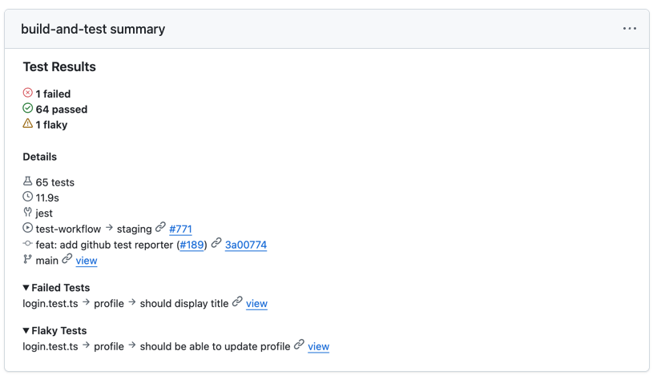
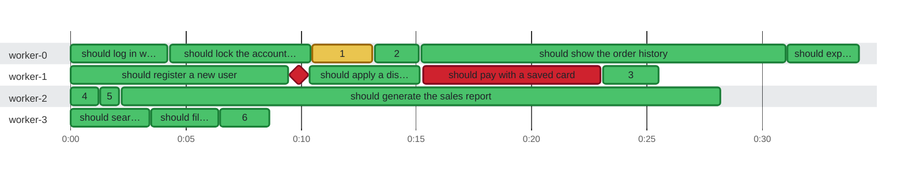

# Report Showcase

A showcase of built-in reports designed to provide detailed insights into test
execution.

## Table of Contents

- [Report Showcase](#report-showcase)
  - [Summary Report](#summary-report)
  - [Summary Delta Report](#summary-delta-report)
  - [GitHub Report](#github-report)
  - [AI Report](#ai-report)
  - [Test Report](#test-report)
  - [Test List Report](#test-list-report)
  - [Failed Report](#failed-report)
  - [Fail Rate Report](#fail-rate-report)
  - [Flaky Report](#flaky-report)
  - [Flaky Rate Report](#flaky-rate-report)
  - [Failed Folded Report](#failed-folded-report)
  - [Previous Results Report](#previous-results-report)
  - [Insights Report](#insights-report)
  - [Tests Changed Report](#tests-changed-report)
  - [Slowest Report](#slowest-report)
  - [Timeline Report](#timeline-report)
  - [Skipped Report](#skipped-report)
  - [Suite Folded Report](#suite-folded-report)
  - [Suite List Report](#suite-list-report)
  - [File Report](#file-report)
  - [Commit Report](#commit-report)
  - [Pull Request Report](#pull-request-report)

## Summary Report

### Overview

Provides a quick summary of the test results, displayed in a concise table
format. Use it to get an overview of test statuses, including passed, failed,
skipped, pending, flaky and other categories.

### Usage

Set the `summary-report` input to true in your workflow configuration:

```yaml
- name: Publish Test Report
  uses: ctrf-io/github-test-reporter@v1
  with:
    report-path: './ctrf/*.json'
    summary-report: true
  if: always()
```

---

| **Tests 📝** | **Passed ✅** | **Failed ❌** | **Skipped ⏭️** | **Pending ⏳** | **Other ❓** | **Flaky 🍂** | **Duration ⏱️** |
| ------------ | ------------- | ------------- | -------------- | -------------- | ------------ | ------------ | --------------- |
| 10           | 5             | 3             | 1              | 1              | 1            | 3            | 11.0s           |

## Summary Delta Report

### Overview

Provides a quick summary of the test results, displayed in a concise table
format. Use it to get an overview of test statuses, including passed, failed,
skipped, pending, flaky and other categories. Inludes comparison to baseline

### Usage

Set the `summary-delta-report` input to true in your workflow configuration:

```yaml
- name: Publish Test Report
  uses: ctrf-io/github-test-reporter@v1
  with:
    report-path: './ctrf/*.json'
    summary-delta-report: true
  if: always()
```

---

| **Tests 📝** | **Passed ✅** | **Failed ❌** | **Skipped ⏭️** | **Other ❓** | **Flaky 🍂** | **Duration ⏱️** |
| --- | --- | --- | --- | --- | --- | --- |
| **58**&nbsp;&nbsp;&nbsp;&nbsp;*↑2* | **58** | **0** | **0** | **0** | **0** | **11.2s**&nbsp;&nbsp;&nbsp;&nbsp;*↓2ms* |

## File Report

### Overview

Groups test results by file path, providing a file-centric view of test execution. Each file displays summary statistics including the number of passed, failed, flaky, and skipped tests, along with the total execution duration for that file. The report uses expandable sections to show individual test details within each file, making it easy to identify which files contain problematic tests.

File paths are linked directly to GitHub for quick navigation, and when line number information is available, individual test names become clickable links that jump directly to the specific line where the test is defined in the source code. 

Tests without file path information are grouped under "filepath not provided" to help identify missing test metadata.

---

<p><strong>64 passed</strong>, <strong>0 failed</strong>, and <strong>0 other</strong></p>
<table>
  <thead>
    <tr>
      <th>File Path</th>
      <th>Passed</th>
      <th>Failed</th>
      <th>Flaky</th>
      <th>Other</th>
      <th>Duration</th>
    </tr>
  </thead>
  <tbody>
    <tr>
      <td>
        <details>
          <summary>
            <a href="https://github.com/ctrf-io/github-test-reporter/blob/feat/file-report/__tests__/handlebars/string.test.ts">✅ __tests__/handlebars/string.test.ts</a>
          </summary>
          <div>&nbsp;&nbsp;&nbsp;&nbsp;&nbsp;&nbsp;&nbsp;&nbsp;✅ String Helpers splitLines should split lines correctly for multiline strings <em>(19ms)</em></div>
          <div>&nbsp;&nbsp;&nbsp;&nbsp;&nbsp;&nbsp;&nbsp;&nbsp;✅ String Helpers splitLines should filter out empty lines <em>(3ms)</em></div>
          <div>&nbsp;&nbsp;&nbsp;&nbsp;&nbsp;&nbsp;&nbsp;&nbsp;✅ String Helpers splitLines should handle undefined values gracefully <em>(2ms)</em></div>
          <div>&nbsp;&nbsp;&nbsp;&nbsp;&nbsp;&nbsp;&nbsp;&nbsp;✅ String Helpers splitLines should handle null values gracefully <em>(2ms)</em></div>
          <div>&nbsp;&nbsp;&nbsp;&nbsp;&nbsp;&nbsp;&nbsp;&nbsp;✅ String Helpers splitLines should handle empty strings <em>(2ms)</em></div>
          <div>&nbsp;&nbsp;&nbsp;&nbsp;&nbsp;&nbsp;&nbsp;&nbsp;✅ String Helpers splitLines should handle strings with only whitespace <em>(2ms)</em></div>
          <div>&nbsp;&nbsp;&nbsp;&nbsp;&nbsp;&nbsp;&nbsp;&nbsp;✅ String Helpers splitLines should handle single line strings <em>(3ms)</em></div>
        </details>
      </td>
      <td>✅ 7</td>
      <td></td>
      <td></td>
      <td></td>
      <td>33ms</td>
    </tr>
    <tr>
      <td>
        <details>
          <summary>
            <a href="https://github.com/ctrf-io/github-test-reporter/blob/feat/file-report/__tests__/ctrf/helpers.test.ts">✅ __tests__/ctrf/helpers.test.ts</a>
          </summary>
          <div>&nbsp;&nbsp;&nbsp;&nbsp;&nbsp;&nbsp;&nbsp;&nbsp;✅ getEmoji returns the correct emoji for &quot;passed&quot; <em>(1ms)</em></div>
          <div>&nbsp;&nbsp;&nbsp;&nbsp;&nbsp;&nbsp;&nbsp;&nbsp;✅ getEmoji returns the correct emoji for &quot;failed&quot; <em>(1ms)</em></div>
          <div>&nbsp;&nbsp;&nbsp;&nbsp;&nbsp;&nbsp;&nbsp;&nbsp;✅ getEmoji returns the correct emoji for &quot;skipped&quot; <em>(1ms)</em></div>
          <div>&nbsp;&nbsp;&nbsp;&nbsp;&nbsp;&nbsp;&nbsp;&nbsp;✅ getEmoji returns the correct emoji for &quot;pending&quot; <em>(2ms)</em></div>
          <div>&nbsp;&nbsp;&nbsp;&nbsp;&nbsp;&nbsp;&nbsp;&nbsp;✅ getEmoji returns the correct emoji for &quot;other&quot; <em>(3ms)</em></div>
          <div>&nbsp;&nbsp;&nbsp;&nbsp;&nbsp;&nbsp;&nbsp;&nbsp;✅ getEmoji returns the correct emoji for &quot;build&quot; <em>(1ms)</em></div>
          <div>&nbsp;&nbsp;&nbsp;&nbsp;&nbsp;&nbsp;&nbsp;&nbsp;✅ getEmoji returns the correct emoji for &quot;duration&quot; <em>(1ms)</em></div>
          <div>&nbsp;&nbsp;&nbsp;&nbsp;&nbsp;&nbsp;&nbsp;&nbsp;✅ getEmoji returns the correct emoji for &quot;flaky&quot; <em>(1ms)</em></div>
          <div>&nbsp;&nbsp;&nbsp;&nbsp;&nbsp;&nbsp;&nbsp;&nbsp;✅ getEmoji returns the correct emoji for &quot;tests&quot; <em>(1ms)</em></div>
          <div>&nbsp;&nbsp;&nbsp;&nbsp;&nbsp;&nbsp;&nbsp;&nbsp;✅ getEmoji returns the correct emoji for &quot;result&quot; <em>(3ms)</em></div>
          <div>&nbsp;&nbsp;&nbsp;&nbsp;&nbsp;&nbsp;&nbsp;&nbsp;✅ stripAnsi removes ANSI escape codes from a string <em>(1ms)</em></div>
          <div>&nbsp;&nbsp;&nbsp;&nbsp;&nbsp;&nbsp;&nbsp;&nbsp;✅ stripAnsi returns the same string if no ANSI codes are present <em>(1ms)</em></div>
          <div>&nbsp;&nbsp;&nbsp;&nbsp;&nbsp;&nbsp;&nbsp;&nbsp;✅ stripAnsi handles empty strings correctly <em>(1ms)</em></div>
          <div>&nbsp;&nbsp;&nbsp;&nbsp;&nbsp;&nbsp;&nbsp;&nbsp;✅ stripAnsi throws a TypeError if the input is not a string <em>(39ms)</em></div>
        </details>
      </td>
      <td>✅ 14</td>
      <td></td>
      <td></td>
      <td></td>
      <td>52ms</td>
    </tr>
    <tr>
      <td>
        <details>
          <summary>
            <a href="https://github.com/ctrf-io/github-test-reporter/blob/feat/file-report/__tests__/ctrf/report-preparation.test.ts">✅ __tests__/ctrf/report-preparation.test.ts</a>
          </summary>
          <div>&nbsp;&nbsp;&nbsp;&nbsp;&nbsp;&nbsp;&nbsp;&nbsp;✅ addFooterDisplayFlags Current suite (no previous results) should set includeFailedReportCurrentFooter when no tests fail in current run <em>(13ms)</em></div>
          <div>&nbsp;&nbsp;&nbsp;&nbsp;&nbsp;&nbsp;&nbsp;&nbsp;✅ addFooterDisplayFlags Current suite (no previous results) should NOT set includeFailedReportCurrentFooter when tests fail in current run <em>(1ms)</em></div>
          <div>&nbsp;&nbsp;&nbsp;&nbsp;&nbsp;&nbsp;&nbsp;&nbsp;✅ addFooterDisplayFlags Current suite (no previous results) should NOT set includeFlakyReportCurrentFooter when flaky tests exist in current run <em>(1ms)</em></div>
          <div>&nbsp;&nbsp;&nbsp;&nbsp;&nbsp;&nbsp;&nbsp;&nbsp;✅ addFooterDisplayFlags Current suite (no previous results) should set includeFlakyReportCurrentFooter when no tests flaky in current run <em>(1ms)</em></div>
          <div>&nbsp;&nbsp;&nbsp;&nbsp;&nbsp;&nbsp;&nbsp;&nbsp;✅ addFooterDisplayFlags Current suite (no previous results) should NOT set footer flags when both failed and flaky tests exist in current run <em>(1ms)</em></div>
          <div>&nbsp;&nbsp;&nbsp;&nbsp;&nbsp;&nbsp;&nbsp;&nbsp;✅ addFooterDisplayFlags Previous suite (with previous results) Current run scenarios should set includeMeasuredOverFooter when tests fail in current run <em>(1ms)</em></div>
          <div>&nbsp;&nbsp;&nbsp;&nbsp;&nbsp;&nbsp;&nbsp;&nbsp;✅ addFooterDisplayFlags Previous suite (with previous results) Current run scenarios should set includeMeasuredOverFooter when flaky tests exist in current run <em>(1ms)</em></div>
          <div>&nbsp;&nbsp;&nbsp;&nbsp;&nbsp;&nbsp;&nbsp;&nbsp;✅ addFooterDisplayFlags Previous suite (with previous results) Current run scenarios should set includeMeasuredOverFooter when both failed and flaky tests exist in current run <em>(1ms)</em></div>
          <div>&nbsp;&nbsp;&nbsp;&nbsp;&nbsp;&nbsp;&nbsp;&nbsp;✅ addFooterDisplayFlags Previous suite (with previous results) All runs scenarios should NOT set includeFailedReportAllFooter when tests failed across all runs <em>(2ms)</em></div>
          <div>&nbsp;&nbsp;&nbsp;&nbsp;&nbsp;&nbsp;&nbsp;&nbsp;✅ addFooterDisplayFlags Previous suite (with previous results) All runs scenarios should NOT set includeFlakyReportAllFooter when flaky tests exist across all runs <em>(1ms)</em></div>
          <div>&nbsp;&nbsp;&nbsp;&nbsp;&nbsp;&nbsp;&nbsp;&nbsp;✅ addFooterDisplayFlags Previous suite (with previous results) All runs scenarios should set includeFailedReportAllFooter when no tests failed across all runs <em>(1ms)</em></div>
          <div>&nbsp;&nbsp;&nbsp;&nbsp;&nbsp;&nbsp;&nbsp;&nbsp;✅ addFooterDisplayFlags Previous suite (with previous results) All runs scenarios should set includeFlakyReportAllFooter when no flaky tests across all runs <em>(1ms)</em></div>
          <div>&nbsp;&nbsp;&nbsp;&nbsp;&nbsp;&nbsp;&nbsp;&nbsp;✅ addFooterDisplayFlags Previous suite (with previous results) Combined scenarios should handle tests failing in current AND across all runs <em>(1ms)</em></div>
          <div>&nbsp;&nbsp;&nbsp;&nbsp;&nbsp;&nbsp;&nbsp;&nbsp;✅ addFooterDisplayFlags Previous suite (with previous results) Combined scenarios should handle flaky tests in current AND across all runs <em>(1ms)</em></div>
          <div>&nbsp;&nbsp;&nbsp;&nbsp;&nbsp;&nbsp;&nbsp;&nbsp;✅ addFooterDisplayFlags Show reports flags should always show reports when only one report enabled <em>(1ms)</em></div>
          <div>&nbsp;&nbsp;&nbsp;&nbsp;&nbsp;&nbsp;&nbsp;&nbsp;✅ addFooterDisplayFlags Show reports flags should hide reports when multiple reports enabled and no failures <em>(1ms)</em></div>
          <div>&nbsp;&nbsp;&nbsp;&nbsp;&nbsp;&nbsp;&nbsp;&nbsp;✅ addFooterDisplayFlags Show reports flags should show failed reports when failures exist <em>(1ms)</em></div>
          <div>&nbsp;&nbsp;&nbsp;&nbsp;&nbsp;&nbsp;&nbsp;&nbsp;✅ addFooterDisplayFlags Show reports flags should show flaky reports when flaky tests exist <em>(1ms)</em></div>
          <div>&nbsp;&nbsp;&nbsp;&nbsp;&nbsp;&nbsp;&nbsp;&nbsp;✅ addFooterDisplayFlags Show reports flags should show skipped reports when skipped tests exist <em>(1ms)</em></div>
          <div>&nbsp;&nbsp;&nbsp;&nbsp;&nbsp;&nbsp;&nbsp;&nbsp;✅ addFooterDisplayFlags Measured Over Footer should set includeMeasuredOverFooter when previous reports exist <em>(1ms)</em></div>
          <div>&nbsp;&nbsp;&nbsp;&nbsp;&nbsp;&nbsp;&nbsp;&nbsp;✅ addFooterDisplayFlags Measured Over Footer should NOT set includeMeasuredOverFooter when no previous reports exist <em>(1ms)</em></div>
          <div>&nbsp;&nbsp;&nbsp;&nbsp;&nbsp;&nbsp;&nbsp;&nbsp;✅ addFooterDisplayFlags Measured Over Footer should NOT set includeMeasuredOverFooter when previous reports array is empty <em>(1ms)</em></div>
        </details>
      </td>
      <td>✅ 22</td>
      <td></td>
      <td></td>
      <td></td>
      <td>24ms</td>
    </tr>
    <tr>
      <td>
        <details>
          <summary>
            <a href="https://github.com/ctrf-io/github-test-reporter/blob/feat/file-report/__tests__/github/handler.test.ts">✅ __tests__/github/handler.test.ts</a>
          </summary>
          <div>&nbsp;&nbsp;&nbsp;&nbsp;&nbsp;&nbsp;&nbsp;&nbsp;✅ createStatusCheck should create a successful check run when no tests failed <em>(6ms)</em></div>
          <div>&nbsp;&nbsp;&nbsp;&nbsp;&nbsp;&nbsp;&nbsp;&nbsp;✅ createStatusCheck should create a failed check run when tests failed <em>(1ms)</em></div>
          <div>&nbsp;&nbsp;&nbsp;&nbsp;&nbsp;&nbsp;&nbsp;&nbsp;✅ createStatusCheck should truncate summary if it exceeds 65000 characters <em>(2ms)</em></div>
          <div>&nbsp;&nbsp;&nbsp;&nbsp;&nbsp;&nbsp;&nbsp;&nbsp;✅ findExistingMarkedComment should return undefined when no comments exist <em>(1ms)</em></div>
          <div>&nbsp;&nbsp;&nbsp;&nbsp;&nbsp;&nbsp;&nbsp;&nbsp;✅ findExistingMarkedComment should return undefined when no comment with marker exists <em>(1ms)</em></div>
          <div>&nbsp;&nbsp;&nbsp;&nbsp;&nbsp;&nbsp;&nbsp;&nbsp;✅ findExistingMarkedComment should find marked comment and identify it is not latest <em>(1ms)</em></div>
          <div>&nbsp;&nbsp;&nbsp;&nbsp;&nbsp;&nbsp;&nbsp;&nbsp;✅ findExistingMarkedComment should find marked comment and identify it is latest <em>(1ms)</em></div>
          <div>&nbsp;&nbsp;&nbsp;&nbsp;&nbsp;&nbsp;&nbsp;&nbsp;✅ findExistingMarkedComment should find the latest marked comment when multiple exist <em>(1ms)</em></div>
          <div>&nbsp;&nbsp;&nbsp;&nbsp;&nbsp;&nbsp;&nbsp;&nbsp;✅ handleComment New PR - All flags disabled should create new comment when no comments exist <em>(1ms)</em></div>
          <div>&nbsp;&nbsp;&nbsp;&nbsp;&nbsp;&nbsp;&nbsp;&nbsp;✅ handleComment New PR - updateComment enabled should create new comment when no comment exists and updateComment enabled <em>(1ms)</em></div>
          <div>&nbsp;&nbsp;&nbsp;&nbsp;&nbsp;&nbsp;&nbsp;&nbsp;✅ handleComment New PR - updateComment enabled should create new comment when no comment exists and updateComment and alwaysLatest enabled <em>(1ms)</em></div>
          <div>&nbsp;&nbsp;&nbsp;&nbsp;&nbsp;&nbsp;&nbsp;&nbsp;✅ handleComment New PR - overwriteComment enabled should create new comment when no comment exists and overwriteComment enabled <em>(1ms)</em></div>
          <div>&nbsp;&nbsp;&nbsp;&nbsp;&nbsp;&nbsp;&nbsp;&nbsp;✅ handleComment New PR - overwriteComment enabled should create new comment when no comment exists and overwriteComment and alwaysLatest enabled <em>(1ms)</em></div>
          <div>&nbsp;&nbsp;&nbsp;&nbsp;&nbsp;&nbsp;&nbsp;&nbsp;✅ handleComment Existing PR - All flags disabled should create new comment when comment found and no flags enabled <em>(1ms)</em></div>
          <div>&nbsp;&nbsp;&nbsp;&nbsp;&nbsp;&nbsp;&nbsp;&nbsp;✅ handleComment Existing PR - updateComment enabled should update existing comment when updateComment enabled <em>(1ms)</em></div>
          <div>&nbsp;&nbsp;&nbsp;&nbsp;&nbsp;&nbsp;&nbsp;&nbsp;✅ handleComment Existing PR - updateComment enabled should update existing comment when updateComment enabled and alwaysLatest enabled and comment is latest <em>(1ms)</em></div>
          <div>&nbsp;&nbsp;&nbsp;&nbsp;&nbsp;&nbsp;&nbsp;&nbsp;✅ handleComment Existing PR - updateComment enabled should create new comment when updateComment enabled and alwaysLatest enabled and comment is not latest <em>(1ms)</em></div>
          <div>&nbsp;&nbsp;&nbsp;&nbsp;&nbsp;&nbsp;&nbsp;&nbsp;✅ handleComment Existing PR - overwriteComment enabled should overwrite existing comment when overwriteComment enabled <em>(1ms)</em></div>
          <div>&nbsp;&nbsp;&nbsp;&nbsp;&nbsp;&nbsp;&nbsp;&nbsp;✅ handleComment Existing PR - overwriteComment enabled should overwrite existing comment when overwriteComment enabled and alwaysLatest enabled and comment is latest <em>(1ms)</em></div>
          <div>&nbsp;&nbsp;&nbsp;&nbsp;&nbsp;&nbsp;&nbsp;&nbsp;✅ handleComment Existing PR - overwriteComment enabled should create new comment when overwriteComment enabled and alwaysLatest enabled and comment is not latest <em>(1ms)</em></div>
          <div>&nbsp;&nbsp;&nbsp;&nbsp;&nbsp;&nbsp;&nbsp;&nbsp;✅ handleViewsAndComments should create a check run with views and comments <em>(38ms)</em></div>
        </details>
      </td>
      <td>✅ 21</td>
      <td></td>
      <td></td>
      <td></td>
      <td>57ms</td>
    </tr>
  </tbody>
</table> 

### Usage

Set the `file-report` input to true in your workflow configuration:

```yaml
- name: Publish Test Report
  uses: ctrf-io/github-test-reporter@v1
  with:
    report-path: './ctrf/*.json'
    file-report: true
  if: always()
```

## GitHub Report

### Overview

Provides a test report that meets the [GitHub Design System](https://primer.style/guides/introduction). Specifically, it uses the GitHub icons and color scheme to acheive a native GitHub look and feel.

The report includes a summary of the test results and an expandable section for failed, flaky, skipped, and pending tests.

it also includes context like git and action information.

### Usage

Set the `github-report` input to true in your workflow configuration:

```yaml
- name: Publish Test Report
  uses: ctrf-io/github-test-reporter@v1
  with:
    report-path: './ctrf/*.json'
    github-report: true
  if: always()
```

---



## AI Report

### Overview

Leverages AI-generated insights to provide detailed summaries for failed tests. For each failure, the report includes an AI-powered explanation of potential causes and suggested solutions to help developers quickly identify and resolve issues. If no AI summary is available for a particular test, the report indicates this clearly. This report is especially useful for streamlining debugging processes and enhancing test reliability by offering actionable insights directly within the test report.

### Usage

Requires AI configuration to be provided.

Set the `ai-report` input to true in your workflow configuration:

```yaml
- name: Publish Test Report
  uses: ctrf-io/github-test-reporter@v1
  with:
    report-path: './ctrf/*.json'
    ai-report: true
    ai: |
      {
        "provider": "openai",
        "model": "gpt-4",
      }
  if: always()
  env:
    OPENAI_API_KEY: ${{ secrets.OPENAI_API_KEY }}
```

---

<table>
    <thead>
        <tr>
            <th>Failed Tests</th>
            <th>AI Summary ✨</th>
        </tr>
    </thead>
    <tbody>
<tr>
            <td>❌ should display title</td>
            <td>The test failed because the page title didn't match the expected value within the given timeout period.<br><br>To resolve this issue, you should first check if the title of the page is correct in your application. It seems there might be a typo or a misunderstanding about what the actual title should be. If 'Common Test Report Format' is indeed the correct title, you'll need to update your test expectations. On the other hand, if 'Uncommon Test Report Format' is the intended title, you'll need to fix the title in your application code.<br><br>Another possibility is that the page might be taking longer to load than expected, causing the title to not appear within the 5-second timeout. In this case, you could try increasing the timeout duration in your test to give the page more time to load completely.</td>
        </tr><tr>
            <td>❌ should fail to update profile on network failure</td>
            <td>No AI summary available</td>
        </tr><tr>
            <td>❌ should fail to update profile on network failure</td>
            <td>No AI summary available</td>
        </tr>    </tbody>
</table>

## Tests Changed Report

### Overview

Displays tests that have been added or removed compared to a baseline or previous run. This report helps track test suite evolution over time by showing exactly which tests are new and which have been removed. Each test is listed with its name and suite hierarchy, making it easy to identify changes in your test coverage.

Requires previous test results or a baseline for comparison.

### Usage

Set the `tests-changed-report` input to true in your workflow configuration:

```yaml
- name: Publish Test Report
  uses: ctrf-io/github-test-reporter@v1
  with:
    report-path: './ctrf/*.json'
    tests-changed-report: true
  if: always()
```

---

**3 new tests added, 1 removed**

### Added ➕

| **Name** | **Suite** |
| --- | --- |
| should handle async operations correctly | API Tests > Authentication |
| should validate user input | API Tests > Validation |
| should cache results properly | Performance Tests |

### Removed ➖

| **Name** | **Suite** |
| --- | --- |
| deprecated legacy test | Legacy Suite > Old Tests |

## Test Report

### Overview

Provides a detailed test report of all executed test cases, including their
status, whether they are marked as flaky, and their execution duration. Use this
table to identify test cases that passed, failed, are skipped, pending, or
marked with other statuses. It also highlights tests that require attention due
to potential flakiness.

### Usage

Set the `test-report` input to true in your workflow configuration:

```yaml
- name: Publish Test Report
  uses: ctrf-io/github-test-reporter@v1
  with:
    report-path: './ctrf/*.json'
    test-report: true
  if: always()
```

---

| **Test Name**                                    | **Status** | **Flaky** | **Duration** |
| ------------------------------------------------ | ---------- | --------- | ------------ |
| should be able to login                          | ✅         |           | 1.2s         |
| should display title                             | ❌         |           | 800ms        |
| should be able to update profile                 | ✅         | 🍂        | 1.2s         |
| should be able to logout                         | ⏭️         |           | 1ms          |
| should validate user settings                    | ✅         |           | 1.1s         |
| should fail to update profile on network failure | ❌         |           | 900ms        |
| should fail to update profile on network failure | ❌         |           | 900ms        |
| should load user data                            | ⏳         |           | 1ms          |
| should handle session timeouts                   | ✅         | 🍂        | 950ms        |
| should clean up user session on logout           | ❓         |           | 1.1s         |
| should allow user to change password             | ✅         | 🍂        | 1.3s         |

## Test List Report

### Overview

Provides a detailed, line-by-line breakdown of all executed test cases, their
statuses, and associated error messages or additional context for failures. This
report is particularly useful for quickly identifying failed tests,
understanding why they failed, and tracking the overall progress of test
execution. Each test case includes its status (e.g., passed, failed, skipped,
etc.) along with any relevant failure details

### Usage

Set the `test-list-report` input to true in your workflow configuration:

```yaml
- name: Publish Test Report
  uses: ctrf-io/github-test-reporter@v1
  with:
    report-path: './ctrf/*.json'
    test-list-report: true
  if: always()
```

---

- **✅ should be able to login**
- **❌ should display title**
  - Timed out 5000ms waiting for `expect(locator).toHaveTitle(expected)`
  - Locator: `locator(':root')`
  - Expected pattern: `/Playwrc cight/`
  - Received string:
    `"Fast and reliable end-to-end testing for modern web apps | Playwright"`
  - Call log:
    - `expect.toHaveTitle` with timeout 5000ms
    - Waiting for `locator(':root')`
    - Locator resolved to
      `<html lang="en" dir="ltr" data-theme="light" data-has-…>…</html>`
    - Unexpected value:
      `"Fast and reliable end-to-end testing for modern web apps | Playwright"`
- **✅ should be able to update profile**
- **⏭️ should be able to logout**
- **✅ should validate user settings**
- **❌ should fail to update profile on network failure**
  - Network Timeout
- **❌ should fail to update profile on network failure**
  - No failure message
- **⏳ should load user data**
- **✅ should handle session timeouts**
- **❓ should clean up user session on logout**
- **✅ should allow user to change password**

## Failed Report

### Overview

Focuses exclusively on failed test cases, providing a clear and concise summary
of each failure. For every failed test, the report includes the test name, the
failure message. This report is designed to help developers quickly diagnose and
address issues.

### Usage

Set the `failed-report` input to true in your workflow configuration:

```yaml
- name: Publish Test Report
  uses: ctrf-io/github-test-reporter@v1
  with:
    report-path: './ctrf/*.json'
    failed-report: true
  if: always()
```

---

<table>
    <thead>
      <tr>
        <th>Failed Tests ❌</th>
        <th>Fail Message</th>
      </tr>
    </thead>
    <tbody>
        <tr>
          <td>❌ should display title</td>
          <td>Timed out 5000ms waiting for expect(locator).toHaveTitle(expected)<br><br>Locator: locator(':root')<br>Expected pattern: /Playwrc cight/<br>Received string:  "Fast and reliable end-to-end testing for modern web apps | Playwright"<br>Call log:<br>  - expect.toHaveTitle with timeout 5000ms<br>  - waiting for locator(':root')<br>  -   locator resolved to <html lang="en" dir="ltr" data-theme="light" data-has-…>…</html><br>  -   unexpected value "Fast and reliable end-to-end testing for modern web apps | Playwright"<br></td>
        </tr>
        <tr>
          <td>❌ should fail to update profile on network failure</td>
          <td>Network Timeout</td>
        </tr>
        <tr>
          <td>❌ should fail to update profile on network failure</td>
          <td>No failure message</td>
        </tr>
    </tbody>
  </table>

## Fail Rate Report

### Overview

Provides a detailed analysis of the fail rates for tests that are currently live
and were executed in the latest run. By incorporating both the current run and
historical data, it provides a comprehensive view of test stability over time.
This report highlights the fail rate for each individual test as well as the
overall fail rate for the entire test execution, helping teams evaluate the
reliability of their test suite and focus on areas that require attention.

The fail rate reflects how often tests fail based on their final outcomes,
excluding any retries. This metric identifies tests with consistent failures,
enabling teams to prioritize fixes and improve overall test reliability.

Use the `previous-results-max` input to state how many previous results to
include in the calculation.

This report goes nicely with the insights-report, flaky-rate-report, and
slowest-report to provide a comprehensive view of the performance of your tests
over time.

Test case fail rate is calculated by dividing the fail count by the total runs
and multiplying by 100:

Fail Rate (%) = (Fail Count ÷ Total Runs) × 100

Overall fail rate across all tests is calculated by summing the fail counts and
total runs of all tests:

Overall Fail Rate (%) = (Total Fail Counts of All Tests ÷ Total Runs of All
Tests) × 100

### Usage

Set the `fail-rate-report` input to true in your workflow configuration:

```yaml
- name: Publish Test Report
  uses: ctrf-io/github-test-reporter@v1
  with:
    report-path: './ctrf/*.json'
    fail-rate-report: true
    previous-results-max: 100
  if: always()
```

---

#### Overall Fail Rate: 13.56%

| Test 📝                                          | Runs 🎯 | Pass ✅ | Fail ❌ | Fail Rate % |
| ------------------------------------------------ | ------- | ------- | ------- | ----------- |
| should fail to update profile on network failure | 12      | 8       | 4       | 33.33       |
| should load user data                            | 9       | 6       | 3       | 33.33       |
| should clean up user session on logout           | 6       | 4       | 2       | 33.33       |
| should display title                             | 10      | 7       | 3       | 30          |
| should be able to logout                         | 8       | 6       | 2       | 25          |

<sub><i>Measured over 6 runs.</i></sub>

## Flaky Report

### Overview

Highlights flaky tests from the current run and lists the number of retries each
test required to achieve a stable outcome. By focusing on these tests, teams can
address potential issues in test reliability.

### Usage

Set the `flaky-rate-report` input to true in your workflow configuration:

```yaml
- name: Publish Test Report
  uses: ctrf-io/github-test-reporter@v1
  with:
    report-path: './ctrf/*.json'
    flaky-rate-report: true
  if: always()
```

---

| **Flaky Tests 🍂**                      | **Retries** |
| --------------------------------------- | ----------- |
| 🍂 should be able to update profile     | 2           |
| 🍂 should handle session timeouts       | 1           |
| 🍂 should allow user to change password | 3           |

## Flaky Rate Report

### Overview

Offers a detailed analysis of flaky rates for tests that are currently live and
were executed in the latest run. By considering both the current run and
historical data, it provides a comprehensive view of test stability over time.
The report calculates flaky rates by factoring in both pass and fail outcomes
across all attempts. It highlights the flaky rate for each test and includes an
overall flaky rate for the entire test execution, helping teams identify and
address unreliable tests effectively.

The flaky rate reflects how often tests exhibit flaky behavior—tests that fail
initially but pass upon retry. Using test retries is essential for detecting
flaky tests within CTRF.

Use the `previous-results-max` input to state how many previous results to
include in the calculation.

This report goes fits nicely with the insights-report, fail-rate-report, and
slowest-report to provide a comprehensive view of the performance of your tests
over time.

Test flaky rate (%) is calculated by dividing the number of flaky occurrences by
the total number of test attempts (including retries) and multiplying by 100:

Flaky Rate (%) = (Flaky Occurrences ÷ Total Attempts) × 100

Overall flaky rate across all tests is calculated by summing the flaky
occurrences and total attempts of all tests:

Overall Flaky Rate (%) = (Total Flaky Occurrences of All Tests ÷ Total Attempts
of All Tests) × 100

### Usage

Set the `flaky-rate-report` input to true in your workflow configuration:

```yaml
- name: Publish Test Report
  uses: ctrf-io/github-test-reporter@v1
  with:
    report-path: './ctrf/*.json'
    flaky-rate-report: true
    previous-results-max: 100
  if: always()
```

---

#### Overall Flaky Rate: 35.29%

| Test 📝                              | Attempts 🎯 | Pass ✅ | Fail ❌ | Flaky Rate % 🍂 |
| ------------------------------------ | ----------- | ------- | ------- | --------------- |
| should allow user to change password | 28          | 7       | 21      | 75.00           |
| should be able to update profile     | 21          | 7       | 14      | 66.67           |
| should handle session timeouts       | 14          | 7       | 7       | 50.00           |

<sub><i>Measured over 7 runs.</i></sub>

## Failed Folded Report

### Overview

Provides a compact and interactive view of failed tests by using collapsible
sections for each failure. Each section includes the test name, failure details,
and trace information to help developers quickly identify and address issues.
This format is particularly useful for organizing extensive failure logs, as it
minimizes visual clutter while still offering access to all the necessary
information. By expanding the collapsible sections, developers can drill down
into specific failure details and traces to diagnose problems efficiently.

### Usage

Set the `failed-folded-report` input to true in your workflow configuration:

```yaml
- name: Publish Test Report
  uses: ctrf-io/github-test-reporter@v1
  with:
    report-path: './ctrf/*.json'
    failed-folded-report: true
  if: always()
```

---

 <table>
  <thead>
    <tr>
      <th>Failed Tests</th>
    </tr>
  </thead>
  <tbody>
      <tr>
        <td>
          <details>
            <summary>❌ should display title</summary>
            <pre><code>Timed out 5000ms waiting for expect(locator).toHaveTitle(expected)
Locator: locator(&#x27;:root&#x27;)
Expected pattern: /Playwrc cight/
Received string:  &quot;Fast and reliable end-to-end testing for modern web apps | Playwright&quot;
Call log:
  - expect.toHaveTitle with timeout 5000ms
  - waiting for locator(&#x27;:root&#x27;)
  -   locator resolved to &lt;html lang&#x3D;&quot;en&quot; dir&#x3D;&quot;ltr&quot; data-theme&#x3D;&quot;light&quot; data-has-…&gt;…&lt;/html&gt;
  -   unexpected value &quot;Fast and reliable end-to-end testing for modern web apps | Playwright&quot;
</code></pre>
            <p><strong>Trace:</strong></p>
            <pre><code>ProfileTest.js:45</code></pre>
          </details>
        </td>
      </tr>
      <tr>
        <td>
          <details>
            <summary>❌ should fail to update profile on network failure</summary>
            <pre><code>Network Timeout</code></pre>
            <p><strong>Trace:</strong></p>
            <pre><code>ProfileUpdateTest.js:60</code></pre>
          </details>
        </td>
      </tr>
      <tr>
        <td>
          <details>
            <summary>❌ should fail to update profile on network failure</summary>
            <pre><code>No message available</code></pre>
            <p><strong>Trace:</strong></p>
            <pre><code>No trace available</code></pre>
          </details>
        </td>
      </tr>
  </tbody>
</table>

## Previous Results Report

### Overview

Provides a historical view of test execution results across recent builds. This
report includes key metrics such as the total number of tests, their statuses
(passed, failed, skipped, pending, and other), flaky test counts, and overall
duration for each build. By linking directly to build summaries, it allows
developers to track trends in test outcomes over time and identify patterns or
recurring issues. This insight helps teams monitor the stability of their test
suite and prioritize areas for improvement based on historical performance.

Use the `previous-results-max` input to state how many previous results to
include in the calculation. The default is 10.

### Usage

Set the `previous-results-report` input to true in your workflow configuration:

```yaml
- name: Publish Test Report
  uses: ctrf-io/github-test-reporter@v1
  with:
    report-path: './ctrf/*.json'
    previous-results-report: true
  if: always()
```

---

| **Build 🏗️**                                                                                      | **Result 🧪** | **Tests 📝** | **Passed ✅** | **Failed ❌** | **Skipped ⏭️** | **Pending ⏳** | **Other ❓** | **Flaky 🍂** | **Duration ⏱️** |
| ------------------------------------------------------------------------------------------------- | ------------- | ------------ | ------------- | ------------- | -------------- | -------------- | ------------ | ------------ | --------------- |
| [#7](https://github.com/Ma11hewThomas/github-test-reporter-test/actions/runs/12818357737#summary) | ❌            | 10           | 5             | 3             | 1              | 1              | 1            | 3            | 11.0s           |
| [#6](https://github.com/Ma11hewThomas/github-test-reporter-test/actions/runs/12818178851)         | ❌            | 10           | 5             | 3             | 1              | 1              | 1            | 3            | 11.0s           |
| [#5](https://github.com/Ma11hewThomas/github-test-reporter-test/actions/runs/12818142979)         | ❌            | 10           | 5             | 3             | 1              | 1              | 1            | 3            | 11.0s           |
| [#4](https://github.com/Ma11hewThomas/github-test-reporter-test/actions/runs/12818015408)         | ❌            | 10           | 5             | 3             | 1              | 1              | 1            | 3            | 11.0s           |
| [#3](https://github.com/Ma11hewThomas/github-test-reporter-test/actions/runs/12817883348)         | ❌            | 10           | 5             | 3             | 1              | 1              | 1            | 3            | 11.0s           |
| [#2](https://github.com/Ma11hewThomas/github-test-reporter-test/actions/runs/12817830233)         | ❌            | 10           | 5             | 3             | 1              | 1              | 1            | 3            | 11.0s           |
| [#1](https://github.com/Ma11hewThomas/github-test-reporter-test/actions/runs/12817798111)         | ❌            | 10           | 5             | 3             | 1              | 1              | 1            | 3            | 11.0s           |

## Insights Report

### Overview

Provides insights about the latest builds. This report includes key metrics
includes key metrics average tests per run, total flaky tests, total failed, and
slowest test (p95). It helps teams to optimise their test suite and improve the
overall test reliability. 

Use the `previous-results-max` input to state how many previous results to
include in the calculation. The default is 10.

This report goes fits nicely with the flaky-rate-report,
fail-rate-report, and slowest-report to provide a comprehensive view of the performance of your test suite overtime.

### Usage

Set the `insights-report` input to true in your workflow configuration:

```yaml
- name: Publish Test Report
  uses: ctrf-io/github-test-reporter@v1
  with:
    report-path: './ctrf/*.json'
    insights-report: true
  if: always()
```

---

| Average Tests per Run | Total Flaky Tests | Total Failed | Slowest Test (p95) |
|----------------------|-------------------|----------------|-------------------|
| 17 | 0 | 0 | 12ms |

<sub><i>Measured over 2 runs.</i></sub>

## Slowest Report

### Overview

Provides a detailed view of the slowest tests from the current and previous results. This report
includes the test name, number of runs, number of failures, failure rate, and
average duration. It helps teams identify and address performance issues in their
test suite.

Use the `previous-results-max` input to state how many previous results to
include in the calculation. The default is 10.

This report fits nicely with the insights-report, fail-rate-report, and
flaky-rate-report to provide a comprehensive view of the performance of your tests
over time.

### Usage

Set the `slowest-report` input to true in your workflow configuration:

```yaml
- name: Publish Test Report
  uses: ctrf-io/github-test-reporter@v1
  with:
    report-path: './ctrf/*.json'
    slowest-report: true
  if: always()
```

---

### Slowest Tests

| Test 📝 | Runs 🎯 | Fail ❌ | Fail Rate % | Average Duration (p95) ⏱️ |
|-----------|-----------------|------------|----------|-----------|
| helpers.test.ts &gt; stripAnsi - stripAnsi throws a TypeError if the input is not a string | 1 | 0 | 0% | 12ms |
| handler.test.ts &gt; createStatusCheck - createStatusCheck should create a successful check run when no tests failed | 1 | 0 | 0% | 5ms |
| helpers.test.ts &gt; getEmoji - getEmoji returns the correct emoji for &quot;passed&quot; | 1 | 0 | 0% | 4ms |
| helpers.test.ts &gt; getEmoji - getEmoji returns the correct emoji for &quot;duration&quot; | 1 | 0 | 0% | 1ms |
| helpers.test.ts &gt; getEmoji - getEmoji returns the correct emoji for &quot;tests&quot; | 1 | 0 | 0% | 1ms |
| helpers.test.ts &gt; stripAnsi - stripAnsi removes ANSI escape codes from a string | 1 | 0 | 0% | 1ms |
| handler.test.ts &gt; createStatusCheck - createStatusCheck should truncate summary if it exceeds 65000 characters | 1 | 0 | 0% | 1ms |

<sub><i>Measured over 2 runs.</i></sub>

## Timeline Report

### Overview

Shows when each test ran and on which thread or worker, as a Gantt chart that
GitHub draws in the job summary. It helps answer how evenly work is spread
across workers, which long test keeps one worker busy while the others wait,
what really ran in parallel, where workers sat idle, and when failures and
retries happened.

- Each thread is one row: `threadId`, or the pytest-xdist worker in
  `extra.worker`. A thread whose tests overlap in time is split into several
  rows; separate processes can share a thread name, like the "Test worker"
  thread of every Gradle test fork. Without thread IDs, or when the threads
  need more than 40 rows, rows are inferred from start and stop times.
- Bars are colored by result, and differ in more than color: green passed, red
  with a white name failed, yellow with a dashed outline a failed attempt that
  was retried (`retryAttempts`), gray any other status, including a skipped
  test that took time. A failure too short to see is drawn as a diamond, or as
  a thin sliver on rows with many of them.
- A test that was retried shows its runs before the retry too. Those runs do
  not record a thread, so they are drawn on their test's thread where it was
  free, and in a row of their own otherwise.
- Below the headline, the slowest test and the test that finished last, the
  one that kept the run going, are named.
- The time axis starts at 0:00 with the first test, and the test timings table
  uses the same clock, so a bar can be found in the table by its row and start
  time. The legend gives the time of 0:00 in UTC. A chart that spans a day or
  more shows dates instead: the axis in the viewer's time zone, the table in
  UTC.
- Test names are written on bars wide enough to hold them. A bar too narrow
  for its name but not for a number carries the number of the test's row in
  the test timings (the # column), so the table is the chart's key. GitHub
  draws the chart without hover text, so a name that does not fit cannot be
  shown on hover. Tests too short to tell apart are merged into one bar
  labelled with their count, which keeps large runs readable and the chart
  within GitHub's diagram size limit. Failures are never merged into the
  passes around them.
- A table per thread shows busy time, idle time and utilization. The test
  timings table lists up to 100 tests, grouped by row; with more, it keeps
  failures, the tests of numbered bars, retried failures and the slowest
  tests.
- If more than 40 rows remain, or the chart would be too large for the
  summary, the rows with failures and the busiest ones are drawn. The test
  timings keep the failures of the rows not drawn, after the drawn rows.
- When one report holds several runs, such as reports merged after re-running
  failed jobs, the wait between them is cut out of the chart at a gray line,
  and a test that ran again shows its earlier result as a run before a retry.
  Earlier runs that a later run repeated, as when a reporter keeps adding to
  the same file, are left out.
- Start and stop times written in seconds, microseconds or nanoseconds are
  converted; with times in whole seconds, the chart shows the order of the
  tests rather than exact times. Go parent tests, which only group their
  subtests, are left out.

The report needs `start` and `stop` times on each test, and `threadId` to show
parallel workers. Skipped and pending tests that took no time are not drawn.
The chart needs Mermaid 10.4 or later, which GitHub.com has; with an older
Mermaid, as on older GitHub Enterprise Server versions, the chart may fail to
draw, or be drawn with one row per test and other colors, while the tables
still work. Mermaid before 11.7 does not draw the gray line that marks a
stretch cut out of the chart.

In pull request comments, the chart is drawn only where GitHub renders Mermaid,
so notification emails show its source. Set `update-comment` or
`overwrite-comment` so that each run updates one comment instead of adding
another.

### Usage

Set the `timeline-report` input to true in your workflow configuration:

```yaml
- name: Publish Test Report
  uses: ctrf-io/github-test-reporter@v1
  with:
    report-path: './ctrf/*.json'
    timeline-report: true
  if: always()
```

---

### Timeline

**16** tests (and **1** run before a retry) on **4** threads in **34.2s** · busy **70%** of the time · up to **4** at once<br>Slowest: `should generate the sales report` (26.0s on `worker-2`) · Last to finish: `should export orders as CSV` at 0:34.200 on `worker-0`



<sub>🟩 passed · 🟥 failed · 🟨 failed, then retried (dashed) · ♦️ failed too fast for a bar · 0:00 = 2026-01-01 08:00:00.000 UTC</sub>
<br><sub>1 skipped or pending test is not shown.</sub>
<br><sub>A number on a bar is the row with that number (#) in the test timings below.</sub>

| Thread | Tests | Runs before a retry | Failed | Busy | Idle | Utilization |
| :--- | ---: | ---: | ---: | ---: | ---: | ---: |
| worker-0 | 5 | 1 | 0 | 33.7s | 500ms | 99% |
| worker-1 | 5 | 0 | 2 | 25.1s | 9.1s | 73% |
| worker-2 | 3 | 0 | 0 | 28.0s | 6.2s | 82% |
| worker-3 | 3 | 0 | 0 | 8.4s | 25.8s | 25% |

<details>
<summary>Test timings (17)</summary>

| # | Start | Duration | Thread | Test | Status |
| ---: | ---: | ---: | :--- | :--- | :--- |
|  | 0:00.000 | 4.2s | worker-0 | should log in with valid credentials | ✅ passed |
|  | 0:04.300 | 6.1s | worker-0 | should lock the account after 3 failures | ✅ passed |
| 1 | 0:10.500 | 2.6s | worker-0 | should reset the password by email (attempt 1) | ❌ failed |
| 2 | 0:13.200 | 1.9s | worker-0 | should reset the password by email | ✅ passed |
|  | 0:15.200 | 15.8s | worker-0 | should show the order history | ✅ passed |
|  | 0:31.100 | 3.1s | worker-0 | should export orders as CSV | ✅ passed |
|  | 0:00.000 | 9.8s | worker-1 | should register a new user | ✅ passed |
|  | 0:09.900 | 0ms | worker-1 | should open the checkout page | ❌ failed |
|  | 0:09.950 | 5.2s | worker-1 | should apply a discount code | ✅ passed |
|  | 0:15.300 | 7.7s | worker-1 | should pay with a saved card | ❌ failed |
| 3 | 0:23.100 | 2.4s | worker-1 | should send the receipt | ✅ passed |
| 4 | 0:00.000 | 1.2s | worker-2 | should keep the cart after reload | ✅ passed |
| 5 | 0:01.300 | 800ms | worker-2 | should update the cart badge | ✅ passed |
|  | 0:02.200 | 26.0s | worker-2 | should generate the sales report | ✅ passed |
|  | 0:00.000 | 3.4s | worker-3 | should search by product name | ✅ passed |
|  | 0:03.500 | 2.9s | worker-3 | should filter by price | ✅ passed |
| 6 | 0:06.500 | 2.1s | worker-3 | should sort by rating | ✅ passed |

</details>

## Skipped Report

### Overview

Provides a summary of tests that were not executed during the current test run.
It includes tests marked as skipped, pending, or categorized as other. This
report helps teams identify tests that are not actively contributing to the test
suite results, allowing for a review of their relevance, implementation status,
or any issues preventing their execution.

### Usage

Set the `skipped-report` input to true in your workflow configuration:

```yaml
- name: Publish Test Report
  uses: ctrf-io/github-test-reporter@v1
  with:
    report-path: './ctrf/*.json'
    skipped-report: true
  if: always()
```

---

| **Tests**                              | **Status** |
| -------------------------------------- | ---------- |
| should be able to logout               | skipped ⏭️ |
| should load user data                  | pending ⏳ |
| should clean up user session on logout | other ❓   |

## Suite Folded Report

### Overview

Organizes test results by suite, providing a structured and interactive view of
test execution. Each suite is displayed in a collapsible section that summarizes
the number of tests that passed, failed, or were marked as other statuses such
as skipped or pending. This format allows developers to quickly navigate large
test suites, focusing on specific areas of interest. Detailed results for each
test are available within the collapsible sections, including execution times
and statuses.

This report is particularly useful for identifying problematic suites,
understanding test distribution, and prioritizing fixes to improve the
reliability of specific areas in the codebase. The concise summary at the top
provides a quick snapshot of the overall test outcomes.

### Usage

Set the `suite-folded-report` input to true in your workflow configuration:

```yaml
- name: Publish Test Report
  uses: ctrf-io/github-test-reporter@v1
  with:
    report-path: './ctrf/*.json'
    suite-folded-report: true
  if: always()
```

---

<p><strong>5 passed</strong>, <strong>3 failed</strong>, and <strong>3 other</strong></p>
<table>
  <thead>
    <tr>
      <th>Suite</th>
      <th>Passed</th>
      <th>Failed</th>
      <th>Other</th>
      <th>Duration</th>
    </tr>
  </thead>
  <tbody>
    <tr>
      <td>
        <details>
          <summary>✅ login.test.ts &gt; login</summary>
          <div>&nbsp;&nbsp;&nbsp;&nbsp;&nbsp;&nbsp;&nbsp;&nbsp;✅ should be able to login</div>
          <div>&nbsp;&nbsp;&nbsp;&nbsp;&nbsp;&nbsp;&nbsp;&nbsp;⏭️ should be able to logout</div>
        </details>
      </td>
      <td>✅ 1</td>
      <td>❌ 0</td>
      <td>⏭️ 1</td>
      <td>1.2s</td>
    </tr>
    <tr>
      <td>
        <details>
          <summary>❌ login.test.ts &gt; profile</summary>
          <div>&nbsp;&nbsp;&nbsp;&nbsp;&nbsp;&nbsp;&nbsp;&nbsp;❌ should display title</div>
          <div>&nbsp;&nbsp;&nbsp;&nbsp;&nbsp;&nbsp;&nbsp;&nbsp;✅ should be able to update profile</div>
        </details>
      </td>
      <td>✅ 1</td>
      <td>❌ 1</td>
      <td>⏭️ 0</td>
      <td>2.0s</td>
    </tr>
    <tr>
      <td>
        <details>
          <summary>✅ settings.test.ts &gt; settings</summary>
          <div>&nbsp;&nbsp;&nbsp;&nbsp;&nbsp;&nbsp;&nbsp;&nbsp;✅ should validate user settings</div>
        </details>
      </td>
      <td>✅ 1</td>
      <td>❌ 0</td>
      <td>⏭️ 0</td>
      <td>1.1s</td>
    </tr>
    <tr>
      <td>
        <details>
          <summary>❌ network.test.ts &gt; network</summary>
          <div>&nbsp;&nbsp;&nbsp;&nbsp;&nbsp;&nbsp;&nbsp;&nbsp;❌ should fail to update profile on network failure</div>
          <div>&nbsp;&nbsp;&nbsp;&nbsp;&nbsp;&nbsp;&nbsp;&nbsp;❌ should fail to update profile on network failure</div>
          <div>&nbsp;&nbsp;&nbsp;&nbsp;&nbsp;&nbsp;&nbsp;&nbsp;✅ should handle session timeouts</div>
          <div>&nbsp;&nbsp;&nbsp;&nbsp;&nbsp;&nbsp;&nbsp;&nbsp;❓ should clean up user session on logout</div>
          <div>&nbsp;&nbsp;&nbsp;&nbsp;&nbsp;&nbsp;&nbsp;&nbsp;✅ should allow user to change password</div>
        </details>
      </td>
      <td>✅ 2</td>
      <td>❌ 2</td>
      <td>⏭️ 1</td>
      <td>5.1s</td>
    </tr>
    <tr>
      <td>
        <details>
          <summary>✅ ungrouped</summary>
          <div>&nbsp;&nbsp;&nbsp;&nbsp;&nbsp;&nbsp;&nbsp;&nbsp;⏳ should load user data</div>
        </details>
      </td>
      <td>✅ 0</td>
      <td>❌ 0</td>
      <td>⏭️ 1</td>
      <td>1ms</td>
    </tr>
  </tbody>
</table>

## Suite List Report

### Overview

Provides a detailed, flat list of all executed tests grouped by their respective
suites. Each suite displays the total number of tests, along with their results
(e.g., passed, failed, or other statuses). This report allows developers to
quickly review all tests within each suite and verify their outcomes.

The Suite List Report is especially useful for confirming comprehensive test
coverage across specific areas of the codebase and ensuring that all tests
within a suite are passing as expected. The inclusion of detailed test names and
their statuses helps teams identify specific areas for further investigation or
improvement.

### Usage

Set the `suite-list-report` input to true in your workflow configuration:

```yaml
- name: Publish Test Report
  uses: ctrf-io/github-test-reporter@v1
  with:
    report-path: './ctrf/*.json'
    suite-list-report: true
  if: always()
```

---

**14 passed**, **0 failed**, and **0 other**

## ✅ `__tests__/ctrf/helpers.test.ts`

- **✅ getEmoji returns the correct emoji for "passed"**
- **✅ getEmoji returns the correct emoji for "failed"**
- **✅ getEmoji returns the correct emoji for "skipped"**
- **✅ getEmoji returns the correct emoji for "pending"**
- **✅ getEmoji returns the correct emoji for "other"**
- **✅ getEmoji returns the correct emoji for "build"**
- **✅ getEmoji returns the correct emoji for "duration"**
- **✅ getEmoji returns the correct emoji for "flaky"**
- **✅ getEmoji returns the correct emoji for "tests"**
- **✅ getEmoji returns the correct emoji for "result"**
- **✅ stripAnsi removes ANSI escape codes from a string**
- **✅ stripAnsi returns the same string if no ANSI codes are present**
- **✅ stripAnsi handles empty strings correctly**
- **✅ stripAnsi throws a TypeError if the input is not a string**

## Commit Report

### Overview

Provides a detailed summary of test results and associated commits for an
execution. It helps teams trace test outcomes back to specific changes in the
codebase

### Usage

Set the `commit-report` input to true in your workflow configuration:

```yaml
- name: Publish Test Report
  uses: ctrf-io/github-test-reporter@v1
  with:
    report-path: './ctrf/*.json'
    commit-report: true
  if: always()
```

---

<p><strong>14 passed</strong>, <strong>0 failed</strong>, and <strong>0 other</strong></p>

| Timestamp         | **Hash**                                                                                                              | **Author**     | Message       |
| ----------------- | --------------------------------------------------------------------------------------------------------------------- | -------------- | ------------- |
| Jan 19, 25, 16:49 | [2eac572](https://github.com/Ma11hewThomas/github-test-reporter-test/commit/2eac57223c6fc070f8657076b2c578363b01f601) | @Ma11hewThomas | third commit  |
| Jan 19, 25, 16:48 | [2ed8310](https://github.com/Ma11hewThomas/github-test-reporter-test/commit/2ed831054406356c12ea1520de632a04ca23bb3e) | @Ma11hewThomas | second commit |
| Jan 19, 25, 16:48 | [23c693e](https://github.com/Ma11hewThomas/github-test-reporter-test/commit/23c693ebfbf42c5526f8d0b8744414c2aa4a8cc6) | @Ma11hewThomas | first commit  |

[Compare before f9aecf1 and after 2eac572](https://github.com/Ma11hewThomas/github-test-reporter-test/compare/f9aecf1b04ed...2eac57223c6f)

## Pull Request Report

### Overview

The Pull Request Report provides a summary of test results for the latest build
associated with a pull request. This report is designed to be included directly
in PR comments, offering a concise and accessible overview of the test outcomes.
It highlights key metrics such as the total number of tests, their statuses
(passed, failed, skipped, pending, etc.), and the total execution duration.

If all tests pass, the report celebrates the success with a clear "All tests
passed!" message. In the case of failures, the report includes a detailed table
of failed tests, making it easy for reviewers to identify and address issues
directly within the pull request context. This report helps streamline the
review process by integrating critical testing insights into the development
workflow.

### Usage

Set the `pull-request-report` input to true in your workflow configuration:

```yaml
- name: Publish Test Report
  uses: ctrf-io/github-test-reporter@v1
  with:
    report-path: './ctrf/*.json'
    pull-request-report: true
  if: always()
```

---

### testing: [Run #88](https://github.com/ctrf-io/github-test-reporter/actions/runs/12737021286#summary)

| **Tests 📝** | **Passed ✅** | **Failed ❌** | **Skipped ⏭️** | **Pending ⏳** | **Other ❓** | **Flaky 🍂** | **Duration ⏱️** |
| ------------ | ------------- | ------------- | -------------- | -------------- | ------------ | ------------ | --------------- |
| 14           | 14            | 0             | 0              | 0              | 0            | 0            | 4.7s            |

### 🎉 **All tests passed!**
